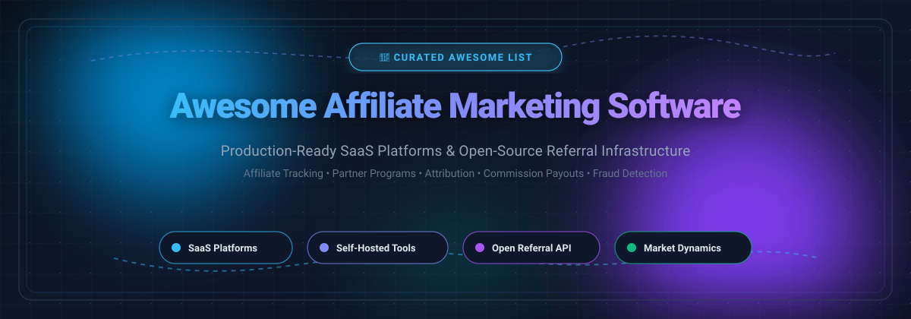

  

# 🚀 Awesome Affiliate Marketing Software

**A curated index of top affiliate marketing platforms, referral tracking systems, partner management tools, and open-source attribution infrastructure.** 🌟 Star if you find it valuable! 🌟

  
  
  
  
  
  
  

*Comprehensive guide for affiliate tracking, partner relationship management (PRM), referral attribution, commission payouts, and self-hosted ad network tracking.*

**Last updated: October 2026** 📅

---

## 📖 Overview & Ecosystem Scope

This repository tracks production-grade **SaaS platforms** and **open-source GitHub projects** designed for **Affiliate Marketing Software** and **Referral Systems**. These tools enable businesses, SaaS founders, and growth engineers to recruit affiliates, track referrals via cookie-less or pixel methods, calculate multi-tier commissions, combat attribution fraud, and automate partner payouts.

- 🏢 **Enterprise SaaS Platforms:** From fully managed ecosystems with global compliance and influencer discovery (e.g., HubSpot, Impact.com, PartnerStack, Everflow) to Stripe-native subscription tracking (e.g., Rewardful, FirstPromoter).
- 💻 **Open-Source Infrastructure:** From lightweight self-hosted conversion analytics and AI-driven affiliate discovery to TDS (traffic distribution) engines and modular referral frameworks for Laravel and Django.

> 💡 **Contributions welcome!** Have an open-source affiliate tool or PRM platform to add? Feel free to open a Pull Request.

---

## 📑 Table of Contents

- [📊 Sector Overview & Market Dynamics](#-sector-overview--market-dynamics)
- [🏢 SaaS/Hosted Platforms](#-saashosted-platforms)
- [💻 Open-Source GitHub Projects](#-open-source-github-projects)
- [🤝 How to Contribute](#-how-to-contribute)
- [📈 Star History](#-star-history)
- [💖 Support & Sponsorship](#-support--sponsorship)
- [⚠️ Disclaimer](#️-disclaimer)

---

## 📊 Sector Overview & Market Dynamics

The global affiliate marketing software and platform sector is estimated at **$2.1 billion to over $5 billion** (powering a broader global affiliate ecosystem spend exceeding **$18 billion to $24 billion** with ~10%-16% CAGR). 

The market is **moderately to highly fragmented** rather than a winner-take-all monopoly: while enterprise orchestration suites (like Impact.com and PartnerStack) capture large brand programs, hundreds of specialized SaaS solutions, e-commerce native plugins, and self-hosted trackers compete across distinct operational niches such as B2B subscription tracking, creator commerce, and media-buyer performance networks.

---

## 🏢 SaaS/Hosted Platforms

| Product | Company Size (Valuation / Revenue) | Pricing | Free Tier / Free Trial Limit | Best For / Description |
| :--- | :--- | :--- | :--- | :--- |
| **[HubSpot Affiliate Management](https://www.hubspot.com/)** | **~$12B - $13.5B Market Cap** (~$3.13B+ ARR) | Free affiliate program to join (30% recurring commission up to 1 yr); CRM platform starter from **$20/month** (Pro from ~$500/month) | **Free Forever Plan** available for HubSpot CRM (up to 1,000,000 contacts & free tools); 14-day free trial on paid Pro editions | HubSpot ecosystem users wanting affiliate contact & pipeline management integrated alongside core CRM/marketing tools. |
| **[Impact.com](https://impact.com/)** | **~$1.5B Valuation** (~$270M+ ARR) | Starts at **$30/month** (or ~2.5%-3% of partner revenue) on Starter; Essentials starts at **$500/month**; Pro at **$2,500/month** | **30-Day Free Trial** on Starter tier (via supported e-commerce integrations such as Shopify); demo required for Essentials/Enterprise | Large brands and scaling enterprises managing complex partner ecosystems across affiliates, creators, influencers, and B2B partners. |
| **[PartnerStack](https://partnerstack.com/)** | **~$150M - $250M Valuation** (Acquired by AppDirect; $38M+ funding) | **$0/month** base on PartnerStack Spark (+ 10% fee on partner payouts); Core plans (Launch/Growth) start at **~$1,000/month** ($9,000+/year) | **Free Forever Plan** on PartnerStack Spark ($0 subscription fee; pay-as-you-transact with 10% commission processing fee); Core tiers offer no free trial (sales demo required) | B2B SaaS companies building ecosystem-led growth with affiliate, referral, and reseller channel programs. |
| **[Everflow](https://www.everflow.io/)** | **~$30M+ ARR** (Bootstrapped / Venture-backed scale) | Starts at **~$750 - $950/month** (with ~$500 setup fee and 6-month minimum contract commitment) | **No Free Tier / No Self-Serve Free Trial** (Guided product demonstration and sales onboarding consultation required) | Performance marketers, ad networks, and enterprise brands needing granular attribution, conversion analytics, and anti-fraud monitoring. |
| **[Post Affiliate Pro](https://www.postaffiliatepro.com/)** | **~$8.2M - $18.7M Annual Revenue** (Quality Unit parent) | Starts at **$79/month** (Starter, billed annually) or **$89/month** (monthly); Pro starts at **$129/month** | **30-Day Free Trial** (full feature access up to plan limits, no credit card required) | Businesses wanting a mature affiliate platform with 200+ integrations, flexible commission rules, and cloud or self-hosted options. |
| **[TUNE](https://www.tune.com/)** | **~$8M - $18M Revenue Estimate** (Acquired by Constellation Software; $36.4M prior funding) | Starts at **~$899 - $1,500/month** (Advertiser Scale tier; custom pricing for affiliate networks) | **No Free Tier / No Self-Serve Free Trial** (Requires custom live demo and consultation with sales engineering team) | Affiliate networks, performance agencies, and large advertisers needing scalable tracking infrastructure and white-label partner consoles. |
| **[Refersion](https://www.refersion.com/)** | **~$5.3M+ ARR** (Acquired by Pantastic / Assembly roll-up) | Starts at **$39/month** (or **$29/month** billed annually) + 3% of affiliate-driven sales; Growth is **$159/month** + 2% | **14-Day Free Trial** (full tracking features); also offers a basic free marketplace listing tier to receive affiliate applications | E-commerce brands (Shopify, BigCommerce, WooCommerce) wanting direct influencer and affiliate tracking tied directly to online store carts. |
| **[Rewardful](https://www.rewardful.com/)** | **~$2.8M ARR** (Acquired by saas.group; 2,600+ SaaS clients) | Starts at **$49/month** (Starter tier for up to $7,500/month affiliate revenue); Growth at **$99/month** (up to $15,000/month) | **14-Day Free Trial** (full access across all tiers with unlimited affiliates and tracked visitors; 0% transaction fee) | SaaS businesses needing clean, Stripe-native affiliate and referral subscription tracking with zero setup hassle. |
| **[Tapfiliate](https://tapfiliate.com/)** | **~$1M ARR Estimate** (Acquired by Mitgo / Admitad) | Starts at **$89/month** (Launch tier, up to 50 affiliates, 5,000 clicks, 500 conversions/month); Scale tier at **$179/month** | **7-Day Free Trial** on Launch tier; **14-Day Free Trial** on Scale tier (full features, API, and automation access) | E-commerce merchants and SaaS startups wanting customizable affiliate portals, multi-language support, and flexible commissions. |
| **[FirstPromoter](https://firstpromoter.com/)** | **~$30M+ Monthly Client MRR Tracked** (Bootstrapped indie SaaS) | Starts at **$49/month** (Starter, up to $5,000/month affiliate revenue, 1,000 promoters); Business at **$99/month** (up to $15,000/month) | **14-Day Free Trial** (full access with no credit card required to test billing integrations with Stripe/Paddle/Chargebee) | Subscription businesses and SaaS founders wanting turnkey affiliate and referral tracking with multi-tier commissions and tax form workflows. |

---

## 💻 Open-Source GitHub Projects

*Sorted in descending order by GitHub_Stars ⭐. Stars_Counts are updated live via badges linking directly to each repository's stargazers.*

1. **[Traffic Source](https://github.com/mddanishyusuf/traffic-source)** 
   - **Focus**: Self-hosted web analytics with Stripe conversion attribution and affiliate management.
   - **Tech Stack**: Next.js 16, React 19, SQLite, Stripe API, Railway one-click deploy.
   - **License**: Custom / Open Repo
   - **Highlights**: Privacy-friendly without cookies, real-time UTM and conversion tracking, affiliate dashboards with custom commission rates, and public partner dashboards.

2. **[Raider](https://github.com/valeriansaliou/raider)** 
   - **Focus**: Affiliates dashboard for partner link generation, balance auditing, and payout logs.
   - **Tech Stack**: Node.js, Express, Pug, Docker.
   - **License**: Apache-2.0
   - **Highlights**: Production-grade affiliate dashboard used by commercial platforms to provide partners with customized tracking code generation, commission history, and live balances.

3. **[mangosqueezy](https://github.com/cluwise/mangosqueezy)** 
   - **Focus**: Autonomous AI agent to scout, recruit, and manage affiliate partners for SaaS products.
   - **Tech Stack**: Python, OpenAI / LLM APIs, LangChain, Playwright.
   - **License**: AGPL-3.0
   - **Highlights**: Automates outbound affiliate recruitment, partner onboarding, and programmatic outreach to scale brand partnerships.

4. **[laravel-referral](https://github.com/voocx/laravel-referral)** 
   - **Focus**: Turnkey referral tracking and commission system for Laravel PHP frameworks.
   - **Tech Stack**: PHP, Laravel, Eloquent ORM.
   - **License**: MIT
   - **Highlights**: Easily integrates into existing Laravel apps to generate unique referral links, track visitor cookies, bind users to referrers, and disburse rewards upon milestone completion.

5. **[Refferq](https://github.com/Refferq/Refferq)** 
   - **Focus**: Open-source referral and affiliate platform designed specifically for SaaS companies.
   - **Tech Stack**: Next.js 15, React 19, TypeScript, PostgreSQL, Prisma, Resend.
   - **License**: Custom / Open Repo
   - **Highlights**: Automated commission calculations, customizable program branding, cookie tracking controls, payout scheduling (NET-15, NET-30 via PayPal, Bank, Wise), and affiliate dashboard.

6. **[eLitius](https://github.com/intelliants/elitius)** 
   - **Focus**: Classic self-hosted affiliate tracking system and manager.
   - **Tech Stack**: PHP, MySQL, Smarty Templates.
   - **License**: GPL-2.0
   - **Highlights**: Complete administrative backend with affiliate registration approval, customizable banner and text link management, real-time impression/click tracking, and commission management.

7. **[django-referral-system](https://github.com/soldatov-ss/django-referral-system)** 
   - **Focus**: Pluggable Django referral program package with promoter management and payout exports.
   - **Tech Stack**: Python, Django, PostgreSQL.
   - **License**: MIT
   - **Highlights**: Handles referral link attribution, promoter dashboard views, commission payout calculation, Wise CSV export generation, and conversion analytics.

8. **[Simple KUMA](https://github.com/kumatrk/initialrelease)** 
   - **Focus**: Self-hosted tracker with Facebook/Meta and Google Ads cost sync for performance media buyers.
   - **Tech Stack**: PHP, MySQL, REST API.
   - **License**: AGPL-3.0
   - **Highlights**: Campaign management wizard, token mapping for ad sources (TikTok, Meta, Google), landing page and offer rotation, S2S postback conversion attribution, and real-time drill-down statistics.

9. **[refearnapp](https://github.com/ZAK123DSFDF/refearnapp)** 
   - **Focus**: High-scale affiliate tracking and referral management suite (open-source alternative to Rewardful and FirstPromoter).
   - **Tech Stack**: Next.js, Cloudflare Edge Workers, Drizzle ORM, Docker.
   - **License**: AGPL-3.0
   - **Highlights**: Edge-optimized link attribution, partner portal, automated commission calculation rules, and developer-first webhook infrastructure.

10. **[slimTDS](https://github.com/izzipizzy/slimtds)** 
    - **Focus**: Traffic distribution and tracking system (TDS) for performance marketing campaigns.
    - **Tech Stack**: FrankenPHP, PostgreSQL, Slim 4, Docker Compose.
    - **License**: AGPL-3.0
    - **Highlights**: Geo/device intelligent routing, conversion postback tracking, session replay via pixel events, Keitaro-like flow schemas, and MCP (Model Context Protocol) server integration.

11. **[Capve](https://github.com/Cap-go/Capve)** 
    - **Focus**: Serverless affiliate tracking for indie hackers and micro-SaaS founders on Cloudflare.
    - **Tech Stack**: React, Vite, Cloudflare Workers (Hono), Cloudflare D1.
    - **License**: Custom / Open Repo
    - **Highlights**: Lightweight link attribution, server-side conversion webhooks, zero server maintenance via Cloudflare D1, and built-in MCP server support.

12. **[RefRef](https://github.com/jpgaviria2/refref)** 
    - **Focus**: Full-stack referral and affiliate infrastructure platform.
    - **Tech Stack**: TypeScript, Next.js, PostgreSQL, Redis, BullMQ, TailwindCSS.
    - **License**: AGPL-3.0
    - **Highlights**: JS snippet attribution, partner affiliate portal, automated email nudges, fraud monitoring heuristics, and testing sandbox.

---

## 🤝 How to Contribute

We welcome contributions from the community! To suggest a new tool or improve an existing listing:

1. 🍴 **Fork** this repository.
2. 🌿 Create a new branch: `git checkout -b feature/add-software-name`.
3. 📝 Update `README.md` with:
   - Platform name & official website/repository URL.
   - Clear classification (SaaS vs. Open-Source).
   - Specific pricing model & free trial limits (for SaaS) or license & GitHub_Stars (for Open-Source).
4. 🚀 Submit a **Pull Request** with a concise description of why the tool is valuable.

---

## 📈 Star History

---

## 💖 Support & Sponsorship

Thank you for visiting and supporting this curated resource! If this project helped you find the right affiliate tracking platform, architectural blueprint, or open-source software:

- ⭐ **Star this repository** to help others discover it.
- 🍴 **Fork and share** it across developer and marketing communities.
- ☕ **Support ongoing maintenance**: You can buy me a coffee and support open-source work directly through the **[GitHub Sponsors Dashboard](https://github.com/sponsors/ishandutta2007)**.

Your support keeps these curated ecosystems updated and verified! 🚀

---

## ⚠️ Disclaimer

- This repository is a **community-curated index** for research, development, and architectural comparison; it does not constitute an official endorsement of any vendor or service.
- **Regulatory Compliance**: Affiliate marketing and attribution platforms handle user tracking, personally identifiable information (PII), and financial commission distributions. Ensure your implementation complies with applicable privacy laws (GDPR, CCPA, ePrivacy) and marketing disclosure mandates (FTC guidelines).
- **Security & Maintenance**: Self-hosted open-source software requires dedicated server hardening, SSL termination, and regular maintenance. Evaluate alpha-stage codebases carefully prior to handling mission-critical partner revenue.

---

  <b>Maintained with ❤️ by <a href="https://github.com/ishandutta2007">Ishan Dutta</a> and contributors.</b> 
  Let's make affiliate tracking more open, developer-friendly, and transparent.

